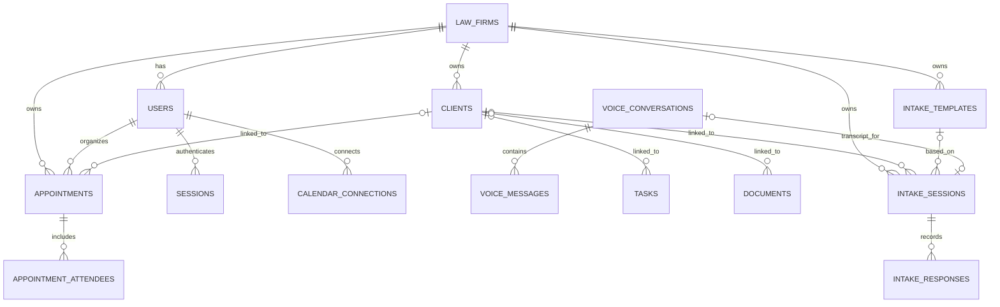
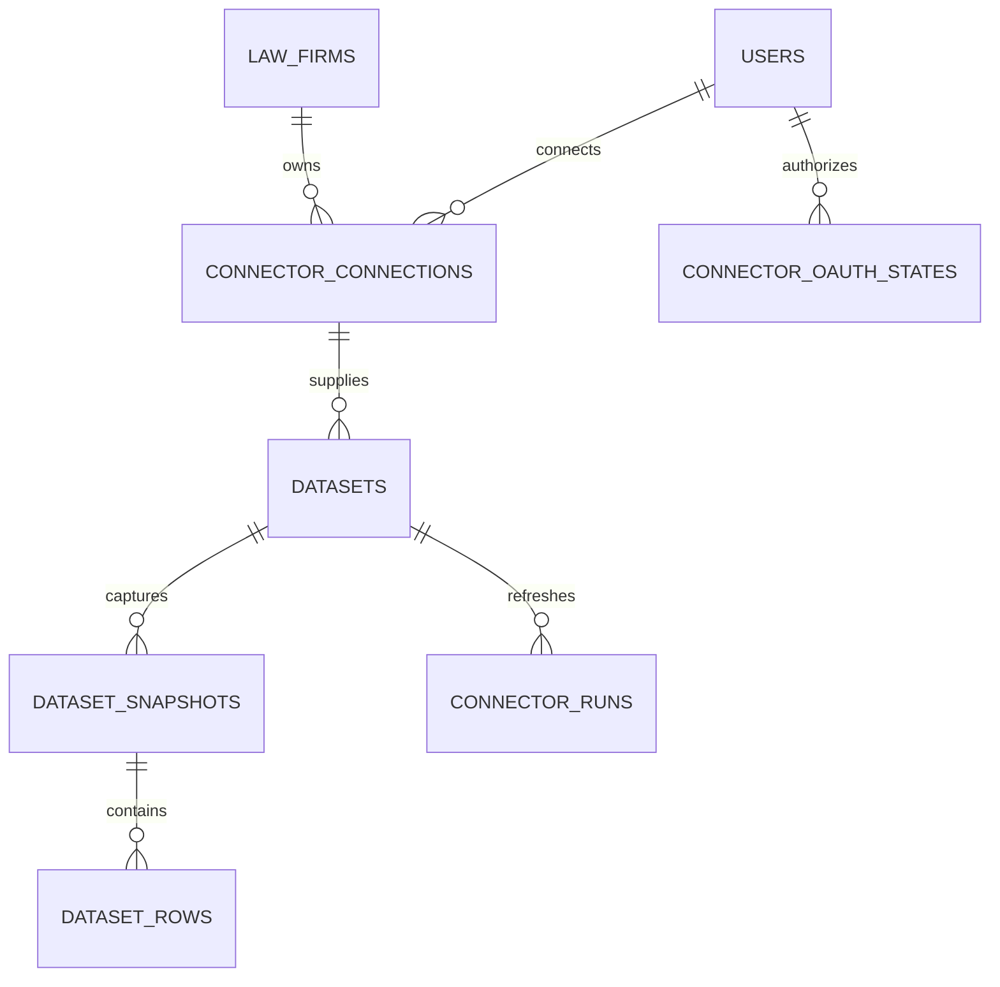

# LegalRoute data model

This README describes the **implemented model** in [schema.ts](schema.ts).
PostgreSQL is the application source of truth; Drizzle defines tables and types.
The read-only Google Sheets dataset MVP is implemented; its model and remaining
extensions are described below and in the [connector guide](../connectors/README.md).

## Ownership and locations

| Location | Responsibility |
| --- | --- |
| `backend/src/db/schema.ts` | Tables, enums, relationships, constraints, indexes |
| `backend/drizzle/` | Ordered migrations and schema snapshots |
| `backend/src/services/` | Validation, authorization context, transactions, business rules |
| `agents/src/` | AI behavior consuming backend-supplied context |
| `legal_route_ai/src/` | UI and Next.js request/cookie adapters |

Run `npm run db:migrate` from the repository root. Generate new migrations with
`npm run db:generate -w backend`. Preserve applied migration files; add corrective
migrations instead of editing history. Migration `0005` copies legacy data into
the Phase 1 model; `0006` adds native appointments and attendees.

## Existing entities

| Domain | Tables | Purpose and relationships |
| --- | --- | --- |
| Firm ownership | `law_firms`, `users` | Users belong to one firm and have an attorney/staff/admin role. Firm settings are JSON preferences. |
| Authentication | `login_tokens`, `sessions` | One-time email tokens and browser sessions store token hashes and expiration times; sessions reference users. |
| Client management | `clients` | Firm-owned clients with contact details, status, matter-type label, and notes. |
| Intake definitions | `intake_templates` | Firm-owned draft/published question configurations in JSON. |
| Intake submissions | `intake_sessions`, `intake_responses` | Sessions optionally reference a template/client and uniquely reference a voice conversation. Responses are unique by session/question ID. |
| Voice history | `voice_conversations`, `voice_messages` | Consent, completion, covered topics, transcript turns, provider/model metadata, and audio paths. |
| Work and documents | `tasks`, `documents`, `activities` | Firm-owned tasks, file metadata/requests, and timeline entries; optional client links. Documents may also reference an intake session. |
| Attorney AI chats | `maya_messages` | Firm-owned messages scoped to home, a client, or a template, optionally linked to a user. |
| Scheduling | `appointments`, `appointment_attendees` | Firm/organizer-owned appointments, optional client link, time range, attendees, cancellation, and edit version. |
| External calendars | `calendar_connections` | User-owned Google/Calendly account credentials and configuration; Apple is an enum value, not an implemented adapter. |
| Legacy cases/settings | `matters`, `app_settings` | Legacy case records and singleton provider/voice settings. These are not fully firm-scoped. |

### Core relationships

This diagram summarizes actual foreign-key relationships; it omits some firm
and optional references for readability. Login tokens identify an email rather
than referencing a user, so an account can be created after link verification.

## Why the model can evolve

1. **Provider-independent domain records.** A client, intake, or appointment has a
   LegalRoute UUID. Connecting another provider need not change that identity or
   turn a provider's row/event ID into the application primary key.
2. **Relational core, flexible form definitions.** Ownership, links, statuses,
   timestamps, and constraints use typed columns. Intake sections/questions and
   firm preferences use JSON where shapes vary. Application validation is still
   required: TypeScript JSON types alone are not database validation.
3. **Published form snapshots.** Templates separate draft and published config;
   intake sessions freeze the questions at start. Editing a template therefore
   does not rewrite an earlier client's intake. This is snapshotting, not a full
   version-history table for every published template.
4. **Optional links support gradual workflows.** Intake can begin before a client
   record exists; an appointment can be scheduled without a client. Later linking
   can preserve the original record and history.
5. **Separate messages and attendees.** Conversations can have many turns and
   appointments many attendees without adding repeated columns to parent tables.
6. **Backend/agent separation.** Backend services own persistence and side effects;
   agents receive context and propose results. Providers can change without
   moving database ownership into prompts or provider SDK code.
7. **Additive migrations.** New domains can add tables and references while old
   data remains readable. SQL enums are explicit contracts: adding a status or
   provider to an existing enum still requires a migration.

## Guarantees and current limits

- Appointments have composite foreign keys enforcing organizer/client membership
  in the same firm. End must follow start and titles cannot be blank. Attendee
  emails are normalized by the service and unique per appointment.
- Scheduling services serialize organizer writes using a transaction advisory
  lock. Overlaps are blocked, adjacent slots allowed, and cancelled slots released.
  A `version` column rejects stale edits. Direct SQL bypasses the overlap rule;
  future sync jobs must use the same service. See [scheduling](../../../docs/scheduling.md).
- Appointment times use `timestamptz` plus an IANA time-zone field. This supports
  consistent instants and local display, but recurrence is not modeled yet.
- Most firm isolation is enforced by service/query filters, not PostgreSQL row
  level security. Older child relationships generally lack composite firm FKs;
  all imports and joins must verify firm ownership explicitly.
- `matters` has no firm/client foreign keys; `law_firms.default_template_id` and
  `maya_messages.scope_id` lack target foreign keys. Address these before case
  linking or generic imports into those relationships.
- One user currently belongs to one firm. Supporting multiple memberships needs
  a membership table and authorization changes. Global `app_settings` needs a
  firm-scoped replacement for independent provider settings per firm.
- `activities` is a timeline, not a complete immutable audit log. Cancellation
  retains appointments; deleting parent records may cascade to children or be
  restricted depending on the actual FK. Retention/archival policy is future work.
- Existing calendar credentials are text columns. The connector proposal below
  improves secret handling; that improvement is not implemented in the old table.
- Intake answer values are text; richer typed fields, custom client attributes,
  full template versioning, and validated custom metadata need deliberate models.

## Implemented connectors: firm-owned datasets

A firm can connect Google Sheets, paste a spreadsheet URL, select a tab, preview
its columns/types, and save a flexible read-only table. Google Sheets remains the
source of truth; LegalRoute stores the latest complete snapshot and supports
manual Refresh. This does not create or update core client records.

| Implemented table | Responsibility |
| --- | --- |
| `connector_connections` | Firm-owned account, connection owner, scopes, encrypted credentials, status/generation |
| `connector_oauth_states` | Expiring one-time user-bound state and encrypted PKCE verifier |
| `datasets` | Source spreadsheet/tab, display name, firm/connection IDs, edit version |
| `dataset_snapshots` | Typed column definitions in JSONB, schema hash, row count, active version |
| `dataset_rows` | Snapshot-local positions, raw text, normalized cell maps and type diagnostics |
| `connector_runs` | Refresh status, counts, safe errors and timestamps |

Columns are embedded in each snapshot rather than modeled as a separate table.
JSONB values allow different firms' datasets to have different columns without
DDL changes. Ownership and source references remain typed relational fields.
Composite firm foreign keys enforce connector/dataset/snapshot/row ownership;
a partial unique index allows one active snapshot per dataset.

The connection owner (attorney) or firm admin manages its tables, and firm members
can view them. Preview hashes and edit versions reject stale saves. Changed column
headers/counts require review. Failed refreshes preserve the prior snapshot;
disconnect purges cached data and prevents in-flight refresh publication. Only the
latest snapshot is retained. Rows have no persistent identity across refreshes.

See [setup, behavior, limitations and verification](../connectors/README.md),
including Google scopes, encryption-key management, resource limits, and the
manual provider test that requires real Google credentials.

### Future extensions

Durable refresh workers, scheduled sync, a Drive picker, stable external row keys,
custom display labels, agent query tools, and client mapping remain future work.
Client mapping should be a separate explicit workflow using backend client
services, per-firm typed record links, validation previews and conflict handling;
never infer client identity from name/email or delete clients when source rows
vanish. Exports need a transactional outbox and safe spreadsheet value handling.
Two-way editing must define a conflict policy before it is enabled.
