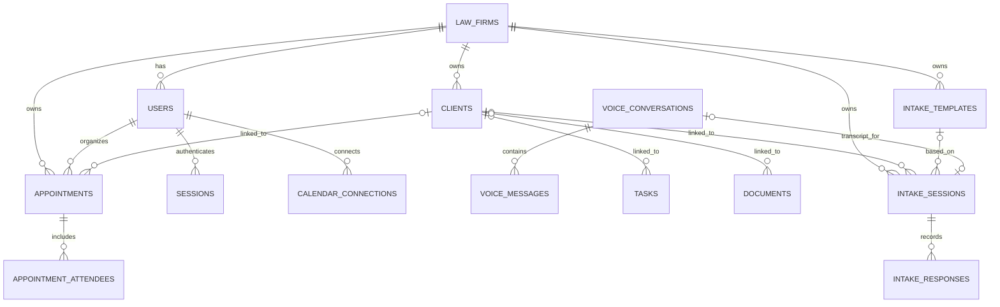
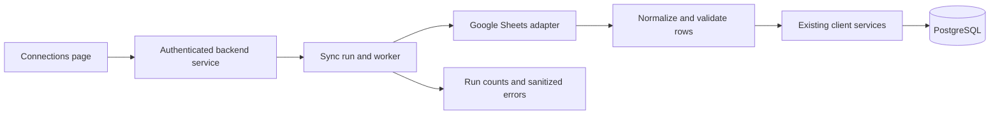

# LegalRoute data model

This README describes the **implemented model** in [schema.ts](schema.ts).
PostgreSQL is the application source of truth; Drizzle defines tables and types.
The generic connector design below is **proposed**, with no connector tables,
Google Sheets authorization, jobs, or sync implemented yet.

## Ownership and locations

| Location | Responsibility |
| --- | --- |
| `backend/src/db/schema.ts` | Tables, enums, relationships, constraints, indexes |
| `backend/drizzle/` | Ordered migrations and schema snapshots |
| `backend/src/services/` | Validation, authorization context, transactions, business rules |
| `agents/src/` | AI behavior consuming backend-supplied context |
| `legal_route_ai/src/` | UI and Next.js request/cookie adapters |

Run `npm run db:migrate` from the repository root. Generate new migrations with
`npm run db:generate -w backend`. Preserve applied migration files; add corrective
migrations instead of editing history. Migration `0005` copies legacy data into
the Phase 1 model; `0006` adds native appointments and attendees.

## Existing entities

| Domain | Tables | Purpose and relationships |
| --- | --- | --- |
| Firm ownership | `law_firms`, `users` | Users belong to one firm and have an attorney/staff/admin role. Firm settings are JSON preferences. |
| Authentication | `login_tokens`, `sessions` | One-time email tokens and browser sessions store token hashes and expiration times; sessions reference users. |
| Client management | `clients` | Firm-owned clients with contact details, status, matter-type label, and notes. |
| Intake definitions | `intake_templates` | Firm-owned draft/published question configurations in JSON. |
| Intake submissions | `intake_sessions`, `intake_responses` | Sessions optionally reference a template/client and uniquely reference a voice conversation. Responses are unique by session/question ID. |
| Voice history | `voice_conversations`, `voice_messages` | Consent, completion, covered topics, transcript turns, provider/model metadata, and audio paths. |
| Work and documents | `tasks`, `documents`, `activities` | Firm-owned tasks, file metadata/requests, and timeline entries; optional client links. Documents may also reference an intake session. |
| Attorney AI chats | `maya_messages` | Firm-owned messages scoped to home, a client, or a template, optionally linked to a user. |
| Scheduling | `appointments`, `appointment_attendees` | Firm/organizer-owned appointments, optional client link, time range, attendees, cancellation, and edit version. |
| External calendars | `calendar_connections` | User-owned Google/Calendly account credentials and configuration; Apple is an enum value, not an implemented adapter. |
| Legacy cases/settings | `matters`, `app_settings` | Legacy case records and singleton provider/voice settings. These are not fully firm-scoped. |

### Core relationships



This diagram summarizes actual foreign-key relationships; it omits some firm
and optional references for readability. Login tokens identify an email rather
than referencing a user, so an account can be created after link verification.

## Why the model can evolve

1. **Provider-independent domain records.** A client, intake, or appointment has a
   LegalRoute UUID. Connecting another provider need not change that identity or
   turn a provider's row/event ID into the application primary key.
2. **Relational core, flexible form definitions.** Ownership, links, statuses,
   timestamps, and constraints use typed columns. Intake sections/questions and
   firm preferences use JSON where shapes vary. Application validation is still
   required: TypeScript JSON types alone are not database validation.
3. **Published form snapshots.** Templates separate draft and published config;
   intake sessions freeze the questions at start. Editing a template therefore
   does not rewrite an earlier client's intake. This is snapshotting, not a full
   version-history table for every published template.
4. **Optional links support gradual workflows.** Intake can begin before a client
   record exists; an appointment can be scheduled without a client. Later linking
   can preserve the original record and history.
5. **Separate messages and attendees.** Conversations can have many turns and
   appointments many attendees without adding repeated columns to parent tables.
6. **Backend/agent separation.** Backend services own persistence and side effects;
   agents receive context and propose results. Providers can change without
   moving database ownership into prompts or provider SDK code.
7. **Additive migrations.** New domains can add tables and references while old
   data remains readable. SQL enums are explicit contracts: adding a status or
   provider to an existing enum still requires a migration.

## Guarantees and current limits

- Appointments have composite foreign keys enforcing organizer/client membership
  in the same firm. End must follow start and titles cannot be blank. Attendee
  emails are normalized by the service and unique per appointment.
- Scheduling services serialize organizer writes using a transaction advisory
  lock. Overlaps are blocked, adjacent slots allowed, and cancelled slots released.
  A `version` column rejects stale edits. Direct SQL bypasses the overlap rule;
  future sync jobs must use the same service. See [scheduling](../../../docs/scheduling.md).
- Appointment times use `timestamptz` plus an IANA time-zone field. This supports
  consistent instants and local display, but recurrence is not modeled yet.
- Most firm isolation is enforced by service/query filters, not PostgreSQL row
  level security. Older child relationships generally lack composite firm FKs;
  all imports and joins must verify firm ownership explicitly.
- `matters` has no firm/client foreign keys; `law_firms.default_template_id` and
  `maya_messages.scope_id` lack target foreign keys. Address these before case
  linking or generic imports into those relationships.
- One user currently belongs to one firm. Supporting multiple memberships needs
  a membership table and authorization changes. Global `app_settings` needs a
  firm-scoped replacement for independent provider settings per firm.
- `activities` is a timeline, not a complete immutable audit log. Cancellation
  retains appointments; deleting parent records may cascade to children or be
  restricted depending on the actual FK. Retention/archival policy is future work.
- Existing calendar credentials are text columns. The connector proposal below
  improves secret handling; that improvement is not implemented in the old table.
- Intake answer values are text; richer typed fields, custom client attributes,
  full template versioning, and validated custom metadata need deliberate models.

## Proposed generic connector feature

A **connector** is a provider adapter (for example, Google Sheets). A
**connection** is a firm's authorized account. A **binding** selects a resource
and maps its data to a LegalRoute domain. Keeping these separate allows one
account to connect multiple spreadsheets and future providers to reuse sync logic.

### Proposed tables (not implemented)

| Table | Key fields and responsibility |
| --- | --- |
| `connector_connections` | `id`, `law_firm_id`, `connected_by_user_id`, `provider_key`, `provider_account_id`, display label, granted scopes, `credential_ref`, status, timestamps. `credential_ref` identifies an encrypted secret; do not place tokens in ordinary JSON config. |
| `connector_bindings` | `id`, firm/connection IDs, external resource ID, tab ID/range, target entity, import/export direction, mapping version, validated mapping JSON, status, sync cursor, timestamps. Starts with client imports. |
| `connector_runs` | `id`, firm/binding IDs, trigger, status, attempt, idempotency key, cursor/checkpoint, record counts, sanitized error summary, start/end times. Provides visible sync history. |
| `connector_record_links` | `id`, firm/binding IDs, external record key, typed target record ID, last external/internal versions or hashes, last run ID. Makes repeat imports update the intended record rather than duplicate it. |
| `connector_run_errors` | `id`, firm/run IDs, external record key, error code, safe field-level details. Supports row-level correction without logging complete client records. |
| `integration_outbox` (later) | Firm, event/entity IDs, event version, destination, status, retry metadata. For reliable exports, write an event in the same transaction as a domain change, then deliver asynchronously. |

Use composite firm FKs throughout. Unique record links should include
`(binding_id, external_record_key)`; also constrain target links according to the
binding's domain semantics. A unique idempotency key prevents duplicate job
creation, but checkpointing and repeat-safe record writes are still needed.

For the first client connector, use a real `client_id` FK in record links. Avoid
an unchecked universal `entity_type/entity_id` pair: a later appointments binding
can use a typed link table or explicit nullable target FKs with a check that
exactly one supported target is set. Validate the target belongs to the binding's
firm and matches its target domain.

`provider_key` can reference a provider catalog table, with adapter capabilities
validated in code (such as `read_clients` or `export_appointments`). Adding a new
provider then usually adds an adapter/catalog entry rather than a column on
`clients`. JSON mapping/config should include a version and validated schema;
credentials, domain ownership, and record identity stay in typed fields.

### Proposed flow and Google Sheets MVP



1. A firm administrator connects Google; the backend stores granted scopes and
   a credential reference. Define admin/delegation permissions before rollout.
2. The user selects a spreadsheet and tab, then maps columns such as `Full name`
   to `clients.name`, `Email` to `clients.email`, and `Phone` to `clients.phone`.
3. Require a stable external record-key column (for example, `LegalRouteRowId`).
   Row numbers are positions, not durable identities; sorting/reordering must not
   import a client twice. Do not silently treat names/emails as unique client IDs.
   For a read-only MVP, the user supplies this key; the connector cannot write it.
4. Preview new/changed/invalid rows before an explicit **Import clients** action.
   First extract the web action's client validation/mutation into a reusable
   backend client service, so UI and connector imports use the same rules.
5. Start with manual, one-way imports. Treat PostgreSQL as authoritative; show
   conflicts when an imported field was subsequently changed in LegalRoute.
   Require explicit resolution rather than silently overwriting local edits.
6. Commit each record and its record-link update atomically. Retry transient
   failures with checkpoints and backoff; deduplicate records across attempts.
   Serialize runs per binding and define handling for edits during a read.
7. Missing rows never imply client deletion. Reject malformed/duplicate row keys,
   missing required columns, and changed mappings with actionable row errors.
8. On disconnect, stop pending work, prevent new runs, and revoke/remove provider
   credentials. Imported clients remain; retain provenance under a defined policy.

Google documents that Sheets OAuth scopes cannot be restricted to an individual
worksheet/tab. App-level selected-resource checks therefore do not narrow the
actual OAuth grant; review file-scoped access options and granted permissions
before implementing the consent flow. See [Google's scope guidance](https://developers.google.com/workspace/sheets/api/scopes).
Google Sheets has API quotas; implement bounded reads and backoff rather than
assuming unlimited requests. See [usage limits](https://developers.google.com/workspace/sheets/api/limits).

### Proposed code ownership

```text
backend/src/connectors/
  registry.ts              Provider IDs, supported operations and config schemas
  google-sheets/           OAuth and Google Sheets adapter
  services/                Connect, preview, import, disconnect, tenant checks
  jobs/                    Durable execution, retries, checkpoints
backend/src/db/schema.ts   Future connector tables and constraints
legal_route_ai/src/app/     Future Connections page and thin request adapters
agents/src/tools/          Optional calls to permission-checked backend operations
```

No connector directories above are scaffolded yet. Start with the client service,
connection/binding/run/link models, and manual Google Sheets import; add scheduled
sync, exports, webhooks, other providers, and two-way conflict resolution later.
Agents should not hold Google credentials or independently choose which external
resources they may access.

## Validation before shipping connectors

Test cross-firm access, stable row identity after reordering, repeated imports,
partial-failure retries, duplicate keys, mapping changes, concurrent jobs, token
expiry/revocation, local-edit conflicts, and disconnect behavior. Use synthetic
spreadsheets and a separate test database. Exported spreadsheet content will also
need a safe policy for formula-like cell values before an export feature ships.
