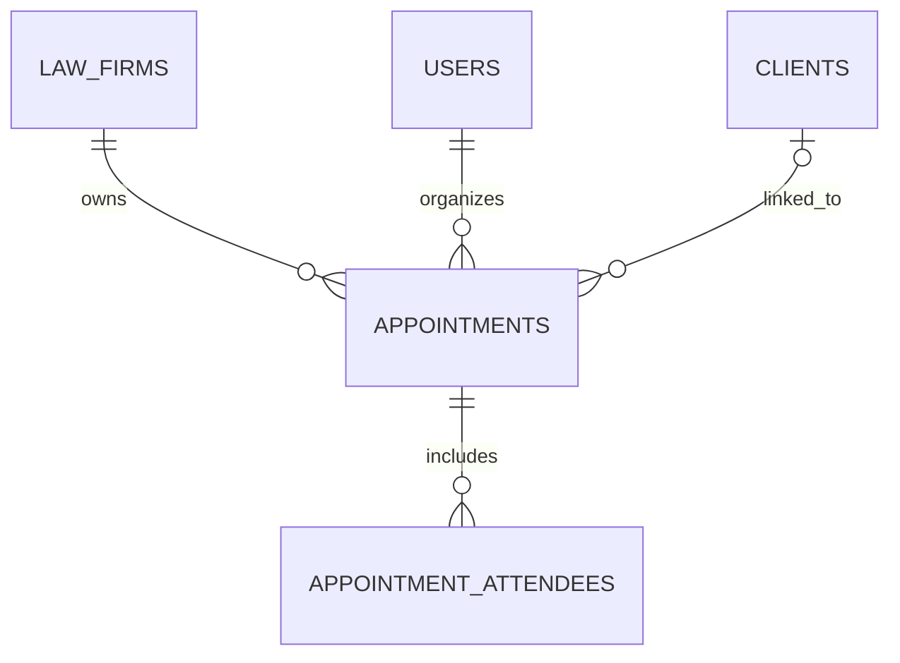

# Native attorney scheduling

Appointments are owned by one attorney and their firm. Calendar providers are
optional integrations, not the source of truth for native appointments.



## Model

- `appointments`: title, organizer, firm, optional client, absolute start/end
  (`timestamptz`), originating IANA time zone, location/meeting link, notes,
  scheduled/cancelled status, optimistic concurrency version, and timestamps.
- `appointment_attendees`: normalized email addresses unique per appointment.
  These are recorded attendees, not invitations or RSVPs.
- Composite foreign keys enforce that the organizer and optional client belong
  to the appointment's firm. Client/user deletion is restricted while linked
  appointments remain; cancellation retains the appointment and its attendees.
- End must follow start; blank titles are rejected in both validation and SQL.
- Indexes support organizer/time and firm/time queries. The initial page loads
  the signed-in attorney's appointments; pagination/range fetching is a future
  scaling improvement.

## Backend rules

`backend/src/services/scheduling/service.ts` is the scheduling write boundary.
Each create/update/cancel authenticates through its Server Action. Only the
organizer may manage an appointment; client selection is scoped to their firm.
Appointment changes, attendee replacement, and activity entries commit together.

An organizer-specific PostgreSQL transaction advisory lock serializes writes.
Scheduled intervals overlap when `existing.start < new.end` and
`existing.end > new.start`. Adjacent appointments are allowed; cancelled ones
release the slot. Overlaps are blocked, rather than allowed with a warning.
Updates and cancellation check a version to reject stale browser submissions.
All future jobs/imports/sync writers must use this service and locking convention;
the overlap rule is not a standalone database exclusion constraint.

The browser converts local form values to absolute instants and supplies its
IANA zone. Nonexistent daylight-saving wall times are rejected by round-trip
validation. During a repeated fall-back hour, JavaScript selects the earlier
occurrence. The calendar displays all events in the viewer's browser time zone.
Changing computers/time zones changes display, not the stored instants.

## Setup and verification

From `legal_route_ai/`, with `DATABASE_URL` configured in `.env.local`:

```sh
npm ci --prefix ..
npm run db:migrate
npm run dev
```

Sign in, then visit `/calendar`. Schedule with or without a client, select an
event to edit it, or cancel it. Use day/week/month and previous/next controls.
Check that a collision reports an error, adjacent events work, cancelled events
can be shown, and a second signed-in attorney cannot see/manage your calendar.
Existing Google/Calendly controls are separate external-service actions; they do
not sync native appointments. No email, AI, or OAuth key is needed for native
scheduling (authentication still uses the app's existing login flow).

```sh
npm run test -w @legalroute/backend
npm run typecheck
npm run lint
npm run build
```

Scheduling tests apply the full migration chain to isolated in-memory PostgreSQL
(PGlite), preserve pre-existing client data, and exercise time/ownership/attendee
constraints, service-level ownership checks, stale-edit rejection, cancellation,
and overlap boundaries. Multi-connection advisory-lock behavior is covered by the optional live
PostgreSQL integration test described below.

## Follow-up model work

- Add firm ownership and client relationships to `matters` before linking cases.
- Add external event mappings and reliable sync jobs for Google/Outlook adapters.
- Design reminders, invitation/RSVP delivery, recurring events, attorney
  availability, and client self-booking as separate features.
- Define firm-wide calendar visibility and appointment delegation permissions.


## Package ownership

The schema is `backend/src/db/schema.ts`; migrations are in `backend/drizzle/`.
Next.js scheduling actions call backend services through compatibility modules.
The scheduling UI remains `legal_route_ai/src/app/(attorney)/calendar/`.
Real PostgreSQL concurrency and authentication coverage is available with
`npm run test:postgres -w backend` from the repository root.
